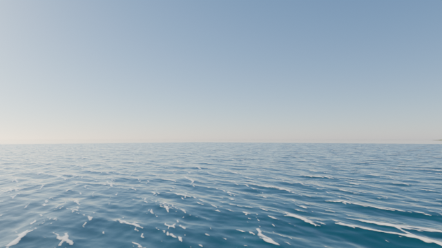
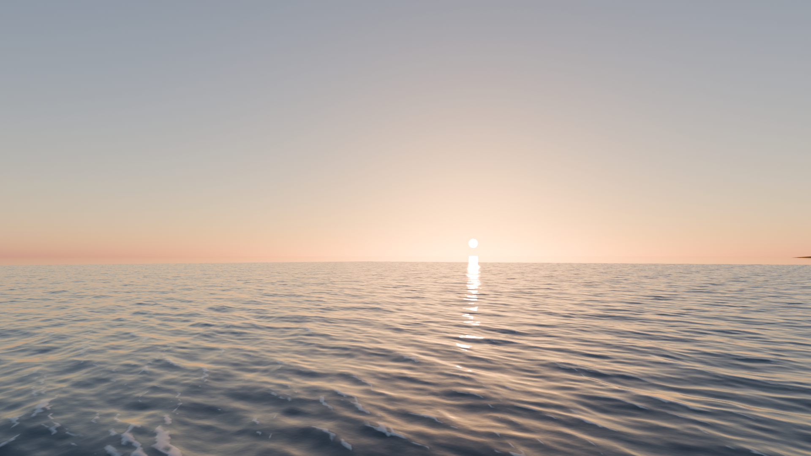
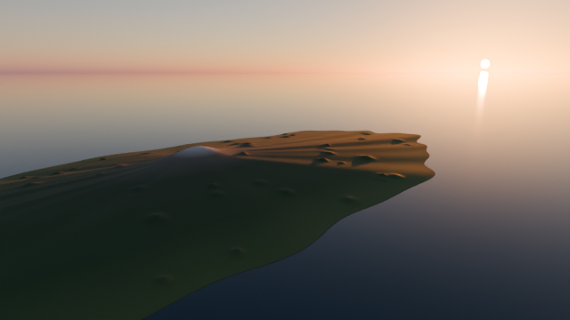

# 🌊 제주 바다 + 움직이는 태양 (Blender)

제주도 지형(DEM) 위에 **실제로 물결치는 바다**를 만들고, **태양이 오후 → 해 질 녘으로 이동**하면서 바다에 비친 빛길도 함께 움직이는 10초 애니메이션을 만듭니다.

| 오후 (1프레임) | 해 질 녘 (220프레임) | 하늘에서 본 섬 (230프레임) |
| --- | --- | --- |
|  |  |  |

> 위 이미지는 DEM 없이 **가상 제주도 지형**으로 렌더한 결과입니다.

---

## 1. 실행 방법

**Blender 4.x / 5.x** 에서 동작합니다. (Blender 5.2로 테스트했습니다.)

1. Blender를 실행합니다.
2. 위쪽 탭에서 **[Scripting]** 을 누릅니다.
3. 텍스트 편집기의 **[Open]** 으로 `jeju_ocean_sun.py`를 엽니다.
4. **▶ (Run Script)** 를 누릅니다. 1~2초면 장면이 만들어집니다.
5. 3D 화면에서 **스페이스바**를 누르면 애니메이션이 재생됩니다.
   - 바다와 태양을 제대로 보려면 화면 오른쪽 위의 **렌더 미리보기**(Rendered) 모드로 바꾸세요.

| 단축키 | 하는 일 |
| --- | --- |
| `F12` | 지금 프레임 한 장 렌더 |
| `Ctrl + F12` | 애니메이션 전체 렌더 (MP4로 저장) |

명령줄에서 바로 렌더하려면:

```bash
blender --background --python jeju_ocean_sun.py --render-anim
```

---

## 2. 만들어지는 것

| 이름 | 내용 |
| --- | --- |
| `JejuTerrain` | DEM으로 만든 제주도 지형. 해안은 검은 현무암, 저지대는 초지, 고지대는 숲과 암석 색이고, 비탈이 급한 곳은 어둡게 칠합니다 |
| `Ocean_Waves` | 카메라 앞 2.4 km × 2.4 km 구역의 **실제 물결** (Ocean 모디파이어, 파도 끝 흰 거품 포함) |
| `Ocean_Far` | 수평선까지 이어지는 먼 바다 (잔물결 노이즈) |
| `Sun` + 하늘 | 다중 산란 하늘(Sky Texture)의 태양과 태양 램프가 **같은 방향으로 함께 이동**합니다. 해가 낮아질수록 주황빛이 됩니다 |
| `Cam_Coast` | (기본 카메라) 남서쪽 해안 25 m 높이에서 해 지는 쪽 바다를 바라봄 |
| `Cam_Island` | 섬 북쪽 9 km 상공에서 섬 전체와 남쪽 바다를 바라봄 |

카메라를 바꾸려면 오른쪽 **Scene 속성 → Camera**에서 고르면 됩니다.

---

## 3. 실제 제주도 DEM 쓰기

스크립트 맨 위의 `DEM_PATH`에 파일 경로를 넣으면 됩니다.

```python
DEM_PATH = r"C:\data\jeju_dem.png"
```

### DEM 구하기
- **국토정보플랫폼** (국토지리정보원): 수치표고모델(DEM)
- **Copernicus DEM GLO-30** 또는 **NASA SRTM** (30 m 해상도): OpenTopography, EarthExplorer 등에서 받을 수 있습니다

### 제주도 범위로 자르고 PNG로 바꾸기 (GDAL)
1. 제주도 범위만 자릅니다. 경도 126.14 ~ 126.97°E, 위도 33.11 ~ 33.57°N입니다.

```bash
gdalwarp -te 126.14 33.11 126.97 33.57 -t_srs EPSG:4326 -r bilinear -ot Float32 input_dem.tif jeju_dem.tif
```

2. 16비트 흑백 PNG로 바꿉니다. 0~2000 m를 0~65535로 바꿉니다.

```bash
gdal_translate -ot UInt16 -scale 0 2000 0 65535 -of PNG jeju_dem.tif jeju_dem.png
```

- 위 범위대로 잘랐다면 `DEM_WIDTH_M = 77000`, `DEM_HEIGHT_M = 51000`을 그대로 쓰면 됩니다. 다른 범위면 실제 동서·남북 거리(m)로 바꾸세요.
- `-scale 0 2000`을 바꿨다면 `DEM_NORMALIZED_MAX_M`도 같은 값으로 맞추세요.
- **16비트 PNG 방식으로 테스트했습니다.** 32비트 실수 GeoTIFF를 바로 넣는 방식도 코드는 있지만 테스트하지 않았습니다. 잘 안 되면 PNG로 바꿔 쓰세요.

---

## 4. 자주 바꾸는 설정 (스크립트 맨 위)

| 설정 | 기본값 | 설명 |
| --- | --- | --- |
| `SUN_AZIMUTH_START / END` | 175 → 245 | 태양 방위각 (북 0°, 동 90°, 남 180°, 서 270°) |
| `SUN_ELEVATION_START / END` | 22 → 1 | 태양 고도 (°). 끝을 -2로 하면 해가 바다 아래로 집니다 |
| `FRAME_END` | 240 | 영상 길이 (24fps → 10초) |
| `OCEAN_WIND_MS` | 9 | 풍속. 올리면 파도가 커집니다 |
| `OCEAN_CHOPPINESS` | 1.3 | 파도 끝의 뾰족함 |
| `VERTICAL_EXAGGERATION` | 1.5 | 지형 높이 과장 배율 |
| `CAMERA_COAST_X_M` | -10000 | 해안 카메라의 동서 위치 (섬 중심 기준, 서쪽이 −) |
| `RENDER_SAMPLES` | 64 | 렌더 품질 |
| `RESOLUTION_PERCENT` | 100 | 50으로 하면 시험 렌더가 약 4배 빨라집니다 |

---

## 5. 렌더 시간

- 테스트 PC에서 Cycles **CPU**로 1920×1080, 64샘플 한 장에 **약 18초** 걸렸습니다.
- 240프레임 전체는 **약 1시간 10분** 걸립니다.
- 그래픽카드가 있다면 **Edit → Preferences → System → Cycles Render Devices**에서 GPU(CUDA / OptiX / HIP)를 켜고, **Render 속성 → Device**를 **GPU Compute**로 바꾸면 훨씬 빨라집니다.
- 결과 영상은 `.blend` 파일을 저장했다면 그 옆의 `jeju_render` 폴더에, 저장하지 않았다면 사용자 폴더(`C:\Users\<이름>\jeju_render`)에 MP4로 저장됩니다.
